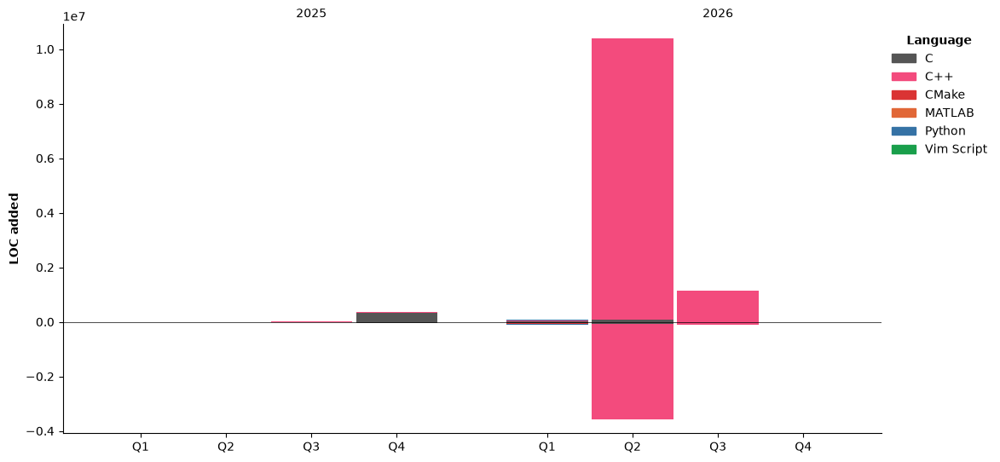

## Hi there 👋, I'm Liu Di, a student from BUAA.

### 致力于打造控制上更优、智能上更强的各种机器人 :robot:

### 梦想成为一名经济自由的极客 :zap:

<!--START_SECTION:waka-->


**🐱 My GitHub Data** 

> 📦 525.5 kB Used in GitHub's Storage 
 > 
> 🏆 697 Contributions in the Year 2026
 > 
> 🚫 Not Opted to Hire
 > 
> 📜 44 Public Repositories 
 > 
> 🔑 2 Private Repositories 
 > 
**I'm a Night 🦉** 

```text
🌞 Morning                281 commits         ███░░░░░░░░░░░░░░░░░░░░░░   12.07 % 
🌆 Daytime                620 commits         ███████░░░░░░░░░░░░░░░░░░   26.62 % 
🌃 Evening                792 commits         █████████░░░░░░░░░░░░░░░░   34.01 % 
🌙 Night                  636 commits         ███████░░░░░░░░░░░░░░░░░░   27.31 % 
```
📅 **I'm Most Productive on Saturday** 

```text
Monday                   224 commits         ██░░░░░░░░░░░░░░░░░░░░░░░   09.62 % 
Tuesday                  320 commits         ███░░░░░░░░░░░░░░░░░░░░░░   13.74 % 
Wednesday                267 commits         ███░░░░░░░░░░░░░░░░░░░░░░   11.46 % 
Thursday                 283 commits         ███░░░░░░░░░░░░░░░░░░░░░░   12.15 % 
Friday                   279 commits         ███░░░░░░░░░░░░░░░░░░░░░░   11.98 % 
Saturday                 660 commits         ███████░░░░░░░░░░░░░░░░░░   28.34 % 
Sunday                   296 commits         ███░░░░░░░░░░░░░░░░░░░░░░   12.71 % 
```


📊 **This Week I Spent My Time On** 

```text
💬 Programming Languages: 
C++                      2 hrs 51 mins       █████████████░░░░░░░░░░░░   51.39 % 
Markdown                 1 hr                █████░░░░░░░░░░░░░░░░░░░░   18.05 % 
CMake                    35 mins             ███░░░░░░░░░░░░░░░░░░░░░░   10.75 % 
Bash                     30 mins             ██░░░░░░░░░░░░░░░░░░░░░░░   09.18 % 
C                        14 mins             █░░░░░░░░░░░░░░░░░░░░░░░░   04.21 % 

🐱‍💻 Projects: 
guganav                  4 hrs 45 mins       █████████████████████░░░░   85.61 % 
DDR-opt                  36 mins             ███░░░░░░░░░░░░░░░░░░░░░░   10.89 % 
transistor_rm2026_algorit11 mins             █░░░░░░░░░░░░░░░░░░░░░░░░   03.50 % 
```

🤖 **AI Coding This Week** 

```text
⏱ AI Coding Time: 2 hrs 19 mins (42.02%)

✍️ 20,993 lines written by AI, 148 lines written by hand (99.3% AI-written)

🔤 31,082,233 Input Tokens, 37,582 Output Tokens

💵 $88.24 Estimated AI Cost This Week

🧠 2 AI Sessions, 9 AI Prompts

Deepseek                 20,922 lines        █████████████████████████   100.00 % 

🔎 AI Coding Insights:
🤖 AI-Driven — 99.3% of written lines came from AI
📝 Concise Prompter — average 92 characters per prompt
🔁 Iterative Prompter — average 4 prompts per session
🚀 High AI Trust — 0.86% of changed lines were hand-edited
```

**I Mostly Code in C++** 

```text
C++                      6 repos             █████████░░░░░░░░░░░░░░░░   35.29 % 
C                        5 repos             ███████░░░░░░░░░░░░░░░░░░   29.41 % 
Python                   3 repos             ████░░░░░░░░░░░░░░░░░░░░░   17.65 % 
MATLAB                   1 repo              █░░░░░░░░░░░░░░░░░░░░░░░░   05.88 % 
Vim Script               1 repo              █░░░░░░░░░░░░░░░░░░░░░░░░   05.88 % 
```


**Timeline**




 Last Updated on 05/08/2026 06:35:24 UTC
<!--END_SECTION:waka-->


<!--
**LemperorD/LemperorD** is a ✨ _special_ ✨ repository because its `README.md` (this file) appears on your GitHub profile.

Here are some ideas to get you started:

- 🔭 I’m currently working on ...
- 🌱 I’m currently learning ...
- 👯 I’m looking to collaborate on ...
- 🤔 I’m looking for help with ...
- 💬 Ask me about ...
- 📫 How to reach me: ...
- 😄 Pronouns: ...
- ⚡ Fun fact: ...
-->
